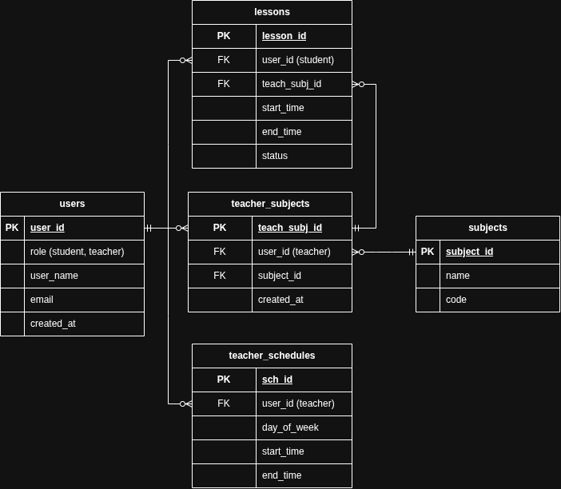

The data description in the current file differs from what is presented in the HTML/CSS/JS project and is more up-to-date. The HTML project will gradually be updated to match the description in this file.

Module 01

## Data that needs to persist

The following data must survive a page reload.

### 1. User (Teacher / Student)
- `role` (string): user role.
- `name` (string): user's name.
- `email` (string): email address.
- `sign-up date` (date): registration date.
- `subjects` (number[]): **multivalued attribute** — array of subject `id`s the user is linked to.

### 2. Subject
- `name` (string): subject name.
- `code` (string): subject code.

### 3. Lesson
- `teacher` (number): reference to a User.
- `student` (number): reference to a User.
- `subject` (number): reference to a Subject.
- `day of the week` (number): day (1–7).
- `start time` (string): lesson start.
- `end time` (string): lesson end.
- `status` (string): lesson status.

### 4. Teacher Schedule
- `teacher` (number): reference to a User.
- `day of the week` (number): day (1–7).
- `start time` (string): available slot start.
- `end time` (string): available slot end.

---
Module 02

## Supabase
- `project name`: learnplat2
- `region`: us-east-1

---
Module 03

# Entities and attributes

| Entity | Attributes | Identifier candidates |
|---|---|---|
| User (Teacher / Student) | role, name, email, sign-up date, **subjects[]** (multivalued) | email |
| Subject | name, code | name, code |
| Lesson | teacher, student, subject, day of the week, start time, end time, status | (no natural one) |
| Teacher Schedule | teacher, day of the week, start time, end time | (no natural one) |

Decision:
- no derived attributes are stored as columns
- `User` entity contains a **multivalued attribute**, which holds more than one value at the same time.

---
Module 04

# Project Relationships

| Relationship | Left Side | Right Side | Type |
| --- | --- | --- | --- |
| `User` has `TeacherSubject` | Exactly one user | Zero or more teacher_subjects | 1:N |
| `Subject` has `TeacherSubject` | Exactly one subject | Zero or more teacher_subjects | 1:N |
| `TeacherSubject` has `Lesson` | Exactly one teacher_subject | Zero or more lessons | 1:N |
| `User` has `Lesson` | Exactly one user | Zero or more lessons | 1:N |
| `User` has `TeacherSchedule` | Exactly one user | Zero or more teacher_schedules | 1:N |

The first two relationships together form an N:N relationship between `User` and `Subject`, resolved through the `TeacherSubject` associative entity. 
Attributes belonging to the `TeacherSubject` link: `teach_subj_id`, `user_id`, `subject_id`, `created_at`.

---
Module 05

# DER

- A user (teacher) has zero or many teacher_subjects; each teacher_subject belongs to exactly one user (teacher).
- A subject has zero or many teacher_subjects; each teacher_subject belongs to exactly one subject.
The last two together form the N:N (many-to-many) relationship between users (teachers) and subjects.
- A teacher_subject has zero or many lessons; each lesson belongs to exactly one teacher_subject.
- A user (student) has zero or many lessons; each lesson belongs to exactly one user (student).
- A user (teacher) has zero or many teacher_schedules; each teacher_schedule belongs to exactly one user (teacher).

---
Module 06
# 1NF
1NF: Fully compliant.

- Each cell has a single value, never a list.
- There are no repeated columns for the same kind of data.
- Each row has a key that uniquely identifies it.
- All rows have the same structure.

---
Module 07
# 2NF, 3NF

2NF: Fully compliant.    
- All tables use single-column surrogate primary keys.
- Since there are no composite keys, partial dependencies are impossible, automatically satisfying 2NF.

3NF: Fully compliant.  
- No transitive dependencies exist
- All non-key attributes depend solely on the primary key, not on each other

Finally, the project model consists of five tables:

- users (user_id PK, role, user_name, email, created_at)
- subjects (subject_id PK, name, code)
- teacher_subjects (teach_subj_id PK, user_id FK, subject_id FK, created_at)
- lessons (lesson_id PK, user_id FK, teach_subj_id FK, day_of_week, start_time, end_time, status)
- teacher_schedules (sch_id PK, user_id FK, day_of_week, start_time, end_time)

---
Module 08
# The project's data dictionary
| Table | Column | Type | Constraints |
| --- | --- | --- | --- |
| `users` | `user_id` | `bigint` | primary key, identity |
| `users` | `role` | `text` | `not null` |
| `users` | `user_name` | `text` | `not null` |
| `users` | `email` | `text` | `not null`, `unique` |
| `users` | `created_at` | `timestamptz` | `not null`, `default now()` |
| `subjects` | `subject_id` | `bigint` | primary key, identity |
| `subjects` | `name` | `text` | `not null`, `unique` |
| `subjects` | `code` | `text` | `not null`, `unique` |
| `teacher_subjects` | `teach_subj_id` | `bigint` | primary key, identity |
| `teacher_subjects` | `user_id` | `bigint` | `not null`, references `users`, `on delete cascade` |
| `teacher_subjects` | `subject_id` | `bigint` | `not null`, references `subjects`, `on delete cascade` |
| `teacher_subjects` | `created_at` | `date` | `not null`, `default current_date` |
| `lessons` | `lesson_id` | `bigint` | primary key, identity |
| `lessons` | `user_id` | `bigint` | `not null`, references `users` |
| `lessons` | `teach_subj_id` | `bigint` | `not null`, references `teacher_subjects` |
| `lessons` | `day_of_week` | `smallint` | `not null`, `check` between 1 and 7 (1 = Monday, 7 = Sunday) |
| `lessons` | `start_time` | `time` | `not null` |
| `lessons` | `end_time` | `time` | `not null` |
| `lessons` | `status` | `text` | `not null` |
| `teacher_schedules` | `sch_id` | `bigint` | primary key, identity |
| `teacher_schedules` | `user_id` | `bigint` | `not null`, references `users` |
| `teacher_schedules` | `day_of_week` | `smallint` | `not null`, `check` between 1 and 7 (1 = Monday, 7 = Sunday) |
| `teacher_schedules` | `start_time` | `time` | `not null` |
| `teacher_schedules` | `end_time` | `time` | `not null` |
